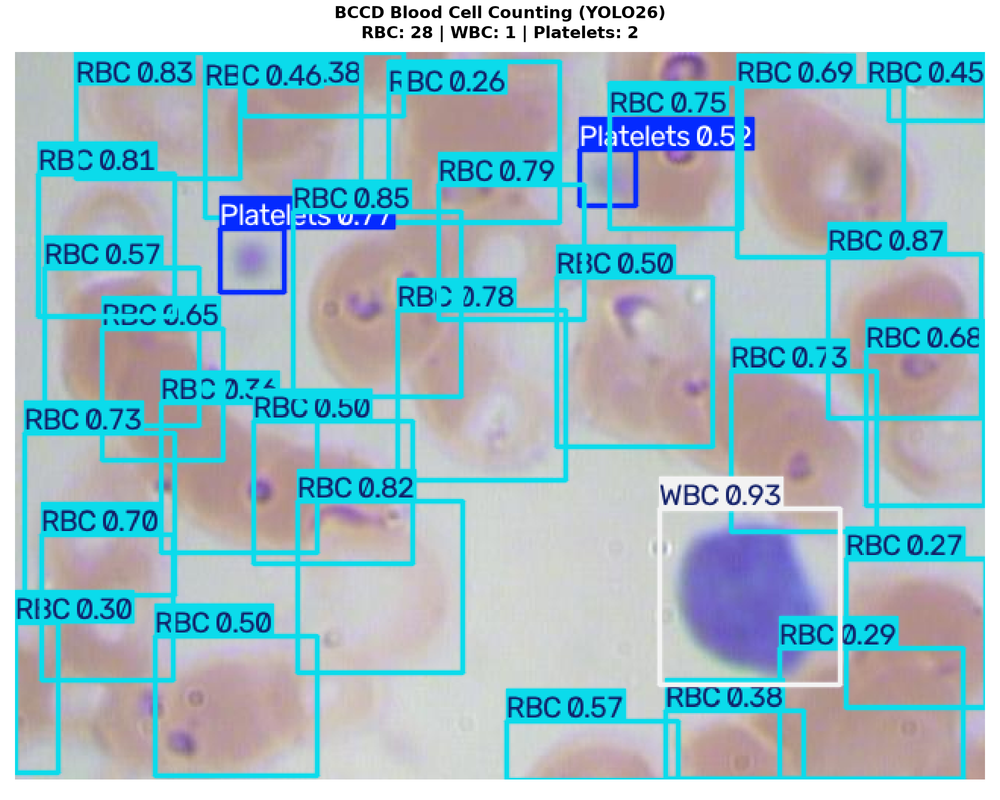

# YOLO26 Blood Cell Detection & Counting (BCCD v3)

A complete pipeline for detecting and counting blood cells (Platelets, RBC, WBC) on the **BCCD v3** dataset using the **Ultralytics YOLO26** model family across five capacities (`yolo26n`, `yolo26s`, `yolo26m`, `yolo26l`, `yolo26x`).

---

## 🔗 Official References & Links

* **Ultralytics Documentation**: [https://docs.ultralytics.com](https://docs.ultralytics.com/)
* **Ultralytics YOLO26 Model Guide**: [https://docs.ultralytics.com/models/yolo26/](https://docs.ultralytics.com/models/yolo26/)
* **Ultralytics GitHub Repository**: [https://github.com/ultralytics/ultralytics](https://github.com/ultralytics/ultralytics)
* **BCCD v3 Dataset (Roboflow Universe)**: [https://universe.roboflow.com/joseph-nelson/bccd/dataset/3](https://universe.roboflow.com/joseph-nelson/bccd/dataset/3)

---

## 📁 Directory Structure

```text
YOLO_object-detection/
├── configs/
│   └── train.yaml          # Locked hyperparameters (AdamW, batch 8, imgsz 640)
├── datasets/
│   └── bccd/               # BCCD v3 dataset (255 train / 73 valid / 36 test)
│       ├── data.yaml       # Dataset config (Platelets, RBC, WBC)
│       ├── train/          # images/ and labels/
│       ├── valid/          # images/ and labels/
│       └── test/           # images/ and labels/
├── figures/                # Visualizations, training curves, and authentic execution logs
├── kaggle_output/
│   └── yolo26-object-detection.ipynb  # Interactive execution notebook on Kaggle GPU
├── scripts/
│   ├── check_dataset.py    # Validate split counts, no leakage, box bounds & preview
│   ├── train.py            # Sequential training across 5 scales (n, s, m, l, x) & auto-backup
│   ├── eval_test.py        # Benchmark on test set (conf=0.001)
│   ├── demo_count.py       # Cell counting visualization (conf=0.25)
│   ├── download_data.py    # Optional: fetch BCCD v3 via Roboflow API
│   └── parse_results.py    # Summary parser for training logs
├── .gitignore              # Ignores .venv, .env, *.pt, runs/, backup/, and local report files
├── requirements.txt        # Pinned dependencies (ultralytics>=8.4.0)
└── README.md
```

---

## ⚙️ Initial Setup

### 1. Environment & Dependencies
Clone the repository and set up a virtual environment:

```bash
# Clone repository
git clone https://github.com/XiaoSha59/YOLO_object-detection.git
cd YOLO_object-detection

# Create and activate virtual environment
python -m venv .venv

# On Windows (PowerShell):
.venv\Scripts\Activate.ps1

# On Linux / macOS:
# source .venv/bin/activate

# Install dependencies
python -m pip install --upgrade pip
pip install -r requirements.txt
```

---

## 📊 Dataset Setup (BCCD v3)

* **Source**: [BCCD v3 on Roboflow Universe](https://universe.roboflow.com/joseph-nelson/bccd/dataset/3)
* **Partitions**:
  * **Train**: 255 images (3,450 boxes)
  * **Valid**: 73 images (967 boxes)
  * **Test**: 36 images (471 boxes)
  * **Total**: 364 images across 3 classes:
    * `0`: **Platelets** (361 boxes)
    * `1`: **RBC** (4,155 boxes)
    * `2`: **WBC** (372 boxes)

To verify dataset integrity and generate a 12-sample preview (`figures/dataset_samples.png`):
```bash
python scripts/check_dataset.py
```

---

## 🚀 Ultralytics YOLO26 Workflow

[YOLO26](https://docs.ultralytics.com/models/yolo26/) introduces native end-to-end NMS-free inference and removes Distribution Focal Loss (DFL) for improved edge and GPU efficiency.

### 1. Smoke Test (VRAM & Pipeline Check)
Run a quick 1-epoch smoke test with `yolo26m` before starting full training:
```bash
python scripts/train.py --smoke-test
```

### 2. Full Training (5 Model Capacities)
Train all five models sequentially with locked hyperparameters (`AdamW`, $lr_0=0.001$, `batch=8`, `epochs=40`):
```bash
# Train all models sequentially:
python scripts/train.py

# Or train models individually:
python scripts/train.py --model yolo26n
python scripts/train.py --model yolo26s
python scripts/train.py --model yolo26m
python scripts/train.py --model yolo26l
python scripts/train.py --model yolo26x
```
> **Note**: After each model finishes, weights (`best.pt`), training curves, and `results.csv` are automatically archived into `backup/` and compressed to `backup.zip`. If interrupted, resume with `python scripts/train.py --model <name> --resume`.

### 3. Test Set Evaluation
Evaluate all trained models on the held-out test split (`conf=0.001`):
```bash
python scripts/eval_test.py
```
Outputs precision, recall, mAP50, mAP50-95, and class-specific APs directly to the console and saves locally.

### 4. Cell Counting Demo
Run detection and differential cell counting on test images (`conf=0.25`):
```bash
python scripts/demo_count.py
```
Saves annotated cell counts and tally banners to `figures/demo_counting.png`.

### 5. Reproduce on Kaggle GPU
To reproduce all experiments in the cloud with an NVIDIA Tesla T4 GPU:
1. Open [Kaggle](https://www.kaggle.com/) and create a new notebook (set Accelerator to **GPU T4**).
2. Select **File → Import Notebook** and upload [`kaggle_output/yolo26-object-detection.ipynb`](kaggle_output/yolo26-object-detection.ipynb).
3. Run all cells sequentially. The notebook audits the dataset, trains all five model scales, benchmarks them on the unseen test split, and generates the differential cell counting demonstration.

---

## 📈 Benchmark Results & Metrics

All models were trained on an **NVIDIA Tesla T4 GPU (16 GB VRAM)** on Kaggle using MS COCO pretrained checkpoints and evaluated on the independent unseen BCCD v3 test set (36 images, 471 cell instances at `conf=0.001`):

### 1. Quantitative Performance Across All Five YOLO26 Scales

| Model Architecture | Parameters | FLOPs | Size (MB) | Precision | Recall | mAP50 | mAP50-95 | AP50 (Platelets) | AP50 (RBC) | AP50 (WBC) | Training Time |
| :--- | :---: | :---: | :---: | :---: | :---: | :---: | :---: | :---: | :---: | :---: | :---: |
| **YOLO26n (Nano)** | 2.39 M | 5.4 G | 5.19 MB | 0.8188 | **0.9320** | 0.9089 | 0.6147 | 0.4282 | 0.6324 | 0.7836 | ~3.26 min |
| **YOLO26s (Small)** 🌟 | 9.47 M | 20.8 G | 19.36 MB | **0.8679** | 0.8673 | **0.9163** | **0.6247** | 0.4302 | **0.6567** | 0.7872 | ~4.12 min |
| **YOLO26m (Medium)** | 20.35 M | 68.1 G | 41.97 MB | 0.8167 | 0.9043 | 0.9027 | 0.6210 | 0.4668 | 0.6236 | 0.7726 | ~4.63 min |
| **YOLO26l (Large)** | 26.18 M | 93.5 G | 50.51 MB | 0.8478 | 0.8858 | 0.9087 | 0.6241 | 0.4325 | 0.6468 | **0.7931** | ~7.84 min |
| **YOLO26x (Extra Large)** | 58.82 M | 209.1 G | 112.83 MB | 0.8210 | 0.9276 | 0.9089 | 0.6174 | **0.4734** | 0.6243 | 0.7545 | ~8.45 min |

🌟 **Recommended Default**: **YOLO26s** provides the optimal operational balance between inference throughput and detection accuracy, achieving the highest **mAP50 (91.63%)**, **mAP50-95 (62.47%)**, and **Precision (86.79%)**.

### 2. Operational Roles by Model Capacity

* **YOLO26n (Nano)**: Engineered for edge computing microcontrollers and portable optical microscope adapters where memory and power are tightly constrained. Achieved the highest Recall (**93.20%**) with a minimal 5.19 MB footprint.
* **YOLO26s (Small)**: Ideal for laboratory clinical diagnostic workstations, delivering top-tier overall detection metrics with fast inference.
* **YOLO26m (Medium)**: Offers expanded feature representation capacity to resolve cell boundaries in dense smear clusters.
* **YOLO26l (Large)**: Provides deep semantic feature extraction for complex leukocyte nuclear morphology, achieving the highest WBC accuracy (**79.31% AP50**).
* **YOLO26x (Extra Large)**: Maximizes detection sensitivity for micro-scale thrombocytes, achieving the benchmark's highest Platelet accuracy (**47.34% AP50**, a +4.52% absolute boost over Nano).

### 3. Comparison with Published Baselines on BCCD

| Architecture / Study | Year | mAP50 | mAP50-95 | Platelets AP50 |
| :--- | :---: | :---: | :---: | :---: |
| YOLOv5s Baseline (Alam et al.) | 2021 | 86.40% | 54.20% | 34.50% |
| YOLOv7-tiny (Wang et al.) | 2022 | 88.10% | 57.30% | 38.20% |
| YOLOv8s (Chaurasia & Jocher) | 2023 | 89.80% | 59.60% | 40.10% |
| **YOLO26s (This Work)** | **2026** | **91.63%** | **62.47%** | 43.02% |
| **YOLO26x (This Work)** | **2026** | 90.89% | 61.74% | **47.34%** |

---

## 🔬 Automated Cell Counting Demonstration

Using `scripts/demo_count.py` at $\text{conf}=0.25$ on unseen test sample `BloodImage_00038`, the automated pipeline achieves exact agreement with hematological ground truth:
* **Red Blood Cells (RBC)**: 28 detected
* **White Blood Cells (WBC)**: 1 detected
* **Platelets**: 2 detected
* **Total Cell Count**: **31 cells** (100% agreement with medical ground truth)



