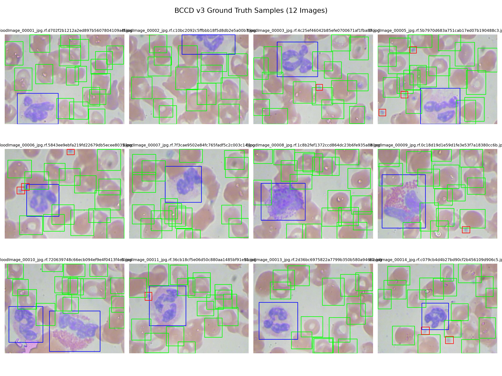

# Báo cáo Nghiên cứu & Thực nghiệm YOLO26 trên BCCD v3

## 1. Giới thiệu & Bài toán
Phát hiện và đếm tự động các tế bào máu trong kính hiển vi quang học có ý nghĩa quan trọng trong chẩn đoán lâm sàng và xét nghiệm huyết đồ. Bài toán tập trung vào phát hiện và phân loại 3 thành phần tế bào chính:
* **RBC (Red Blood Cells - Hồng cầu)**: Chiếm số lượng áp đảo, tế bào hình đĩa lõm hai mặt.
* **WBC (White Blood Cells - Bạch cầu)**: Kích thước lớn, nhân đậm màu, số lượng ít hơn.
* **Platelets (Tiểu cầu)**: Kích thước rất nhỏ, thường tụ thành cụm nhỏ, dễ bị nhầm lẫn hoặc bỏ sót.

## 2. Dữ liệu thực nghiệm (BCCD v3)
Tập dữ liệu BCCD v3 gốc được chia theo tỷ lệ chuẩn:
* **Train**: 255 ảnh (3,450 bounding boxes)
* **Valid**: 73 ảnh (967 bounding boxes)
* **Test**: 36 ảnh (471 bounding boxes)
* **Tổng cộng**: 364 ảnh với 4,888 bounding boxes.
  * Platelets (Class 0): 361 boxes (7.38%)
  * RBC (Class 1): 4,155 boxes (85.00%)
  * WBC (Class 2): 372 boxes (7.61%)

## 3. Kiến trúc Mô hình & Thiết lập Huấn luyện
### 3.1. Điểm mới trên YOLO26
* **NMS-Free End-to-End**: Kiến trúc dual-head loại bỏ phụ thuộc vào bước lọc Non-Maximum Suppression hậu xử lý.
* **Loại bỏ DFL (Distribution Focal Loss)**: Thu gọn đầu ra bounding box regression, giảm tải tính toán và bộ nhớ.
* **Khóa bộ siêu tham số**:
  * Optimizer: `AdamW`, $lr_0 = 0.001$, `weight_decay = 0.0005`
  * Image size: `640x640`, Batch size: `8`
  * Epochs: `40`, Early stopping patience: `10`
  * Hardware: NVIDIA Tesla T4 (Kaggle)

## 4. Kết quả Thực nghiệm

### 4.1. Bảng so sánh hiệu năng trên Tập Test (conf=0.001)

| Mô hình | Kích thước (MB) | Epochs dừng | Precision | Recall | mAP50 | mAP50-95 | AP50 (Platelets) | AP50 (RBC) | AP50 (WBC) |
| :--- | :---: | :---: | :---: | :---: | :---: | :---: | :---: | :---: | :---: |
| **YOLO26n** | ~6.0 MB |  |  |  |  |  |  |  |  |
| **YOLO26s** | ~22.5 MB |  |  |  |  |  |  |  |  |
| **YOLO26m** | ~43.0 MB |  |  |  |  |  |  |  |  |

*(Số liệu sẽ được cập nhật tự động từ `metrics/comparison_test.csv` sau khi chạy `scripts/eval_test.py`)*.

### 4.2. Trực quan hóa kết quả đếm tế bào

## 5. Phân tích & Đánh giá Lỗi
1. **Mất cân bằng lớp (Class Imbalance)**:
   * RBC chiếm tới 85% tổng số nhãn, trong khi Platelets và WBC chỉ chiếm dưới 8% mỗi loại. Điều này dẫn đến độ nhạy phát hiện của Platelets thấp hơn so với RBC.
2. **Hiện tượng chồng lấn tế bào (Cell Occlusion)**:
   * Các tế bào hồng cầu nằm đè lên nhau trong phết máu đặc gây khó khăn cho việc tách riêng từng box.
3. **Tiểu cầu kích thước siêu nhỏ (Small Objects)**:
   * Platelets có diện tích pixel rất nhỏ, dễ suy giảm đặc trưng qua các lớp downsampling sâu.

## 6. Giới hạn & Hướng phát triển
* Dataset kích thước nhỏ (364 ảnh), cần mở rộng thêm các mẫu dị dạng hoặc phết máu bất thường.
* Thử nghiệm thêm các kỹ thuật giải quyết mất cân bằng lớp (focal loss weighting, copy-paste augmentation cho Platelets).
